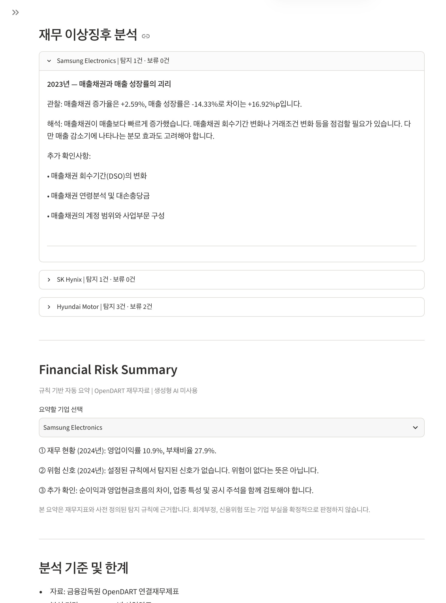
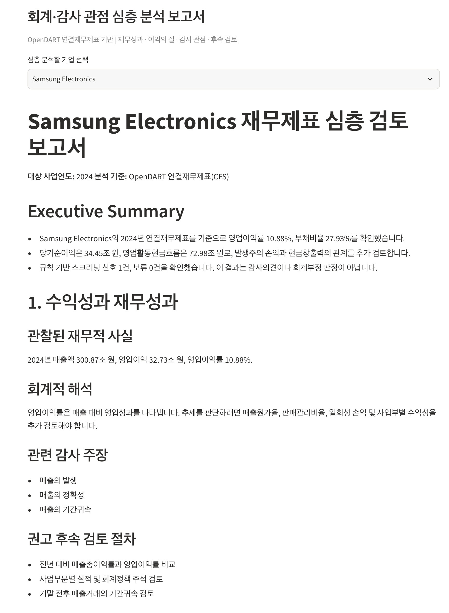
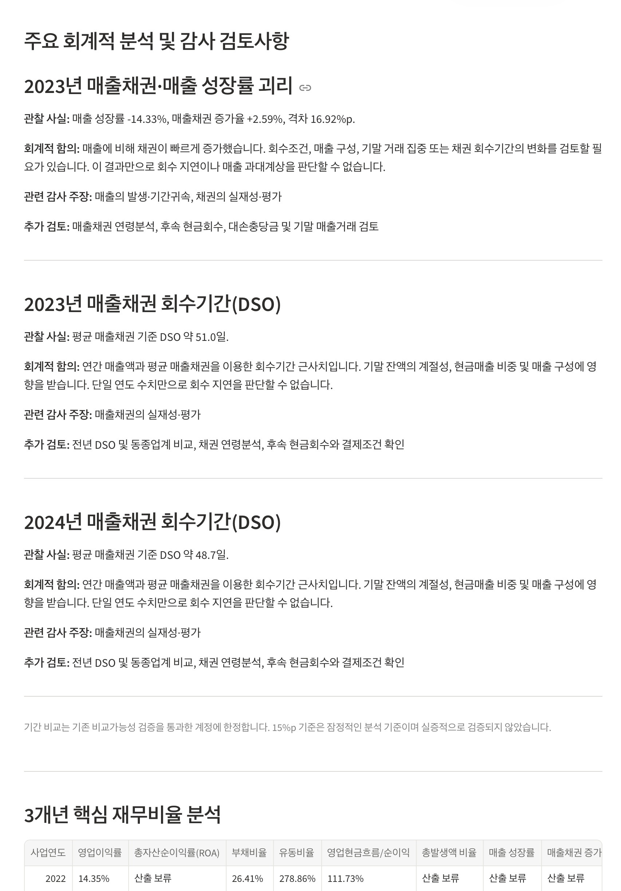
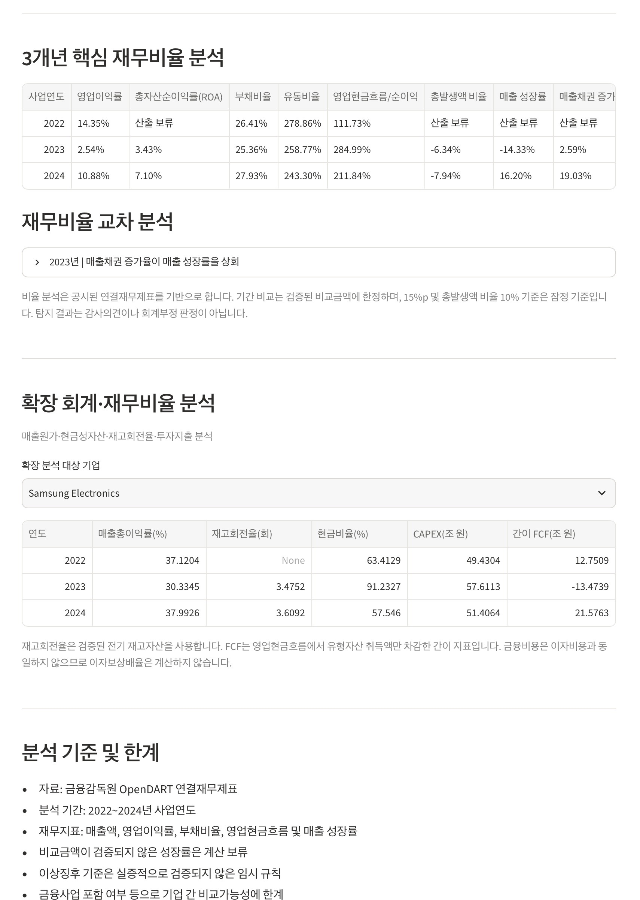
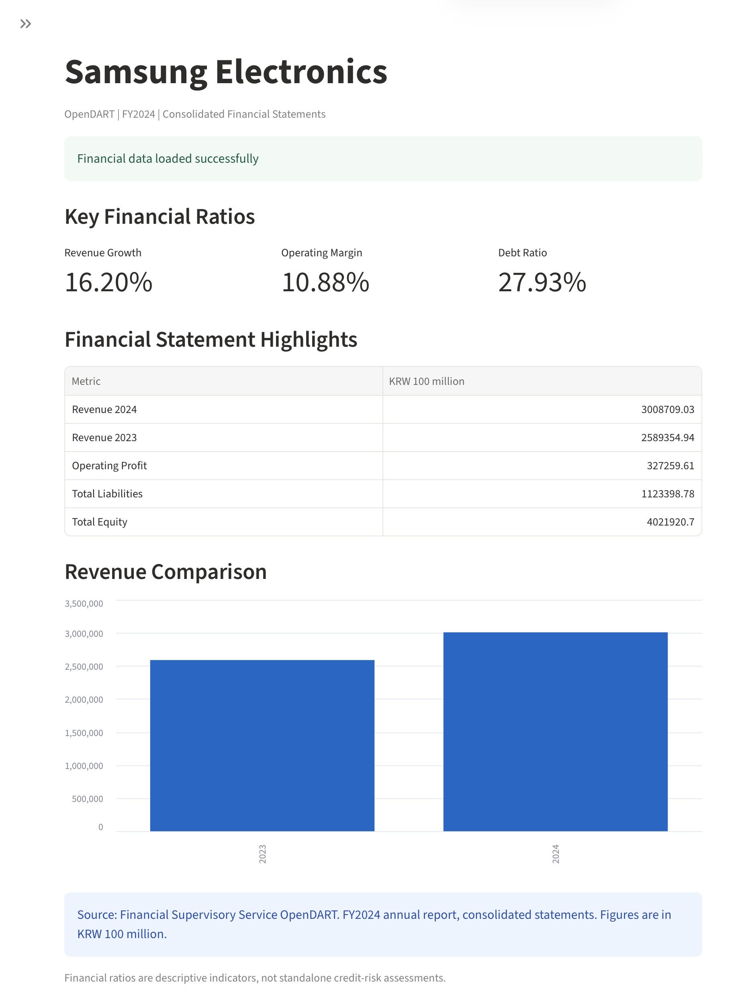

# Corporate Risk Intelligence

**OpenDART 기반 기업 재무제표 분석 및 회계·감사 검토 지원 대시보드**

*Financial Statement Analysis · Comparative Validation · Accounting Insights · Explainable Risk Screening*

[대시보드 실행하기](https://corporate-risk-intelligence.streamlit.app)

## Project Overview

금융감독원 OpenDART API를 활용하여 국내 주요 상장기업의 연결재무제표를 수집하고, 재무성과·재무안정성·현금흐름·운전자본을 분석하는 Python·Streamlit 프로젝트입니다.

단순한 재무비율 계산을 넘어 **계정과목 간 관계를 분석하고, 회계적 함의와 관련 감사 주장 및 추가 검토사항을 제시하는 것**을 목표로 개발했습니다.

특히 공시 연도 간 비교금액의 일관성을 점검하고, 검증되지 않은 비교정보를 이용한 일부 분석은 보류하도록 설계했습니다.

> **분석 대상:** 삼성전자 · SK하이닉스 · 현대자동차  
> **분석 기간:** 2022~2024 사업연도  
> **재무제표 범위:** 연결재무제표(CFS)  
> **분석 방식:** Python 규칙 기반 분석 및 자동 보고서 생성  
> **생성형 AI:** 현재 사용하지 않음

## Key Features

### 1. Financial Statement Dashboard

- 기업별 3개년 매출액·영업이익률·부채비율·영업현금흐름 시각화
- 기업별 재무성과와 재무구조 비교
- 주요 계정과목 및 재무비율 분석

### 2. Accounting Ratio Analysis

**기본 재무비율**
- 영업이익률 및 총자산순이익률(ROA)
- 부채비율 및 유동비율
- 영업현금흐름/순이익 비율
- 총발생액 비율
- 매출액·매출채권·재고자산 증가율

**확장 재무비율**
- 매출총이익률
- 재고회전율
- 현금비율
- 유형자산 취득액(CAPEX)
- 간이 잉여현금흐름(FCF)

일부 지표는 필요한 계정과 비교금액이 확인되는 경우에만 산출합니다.

### 3. Financial Risk Screening

- 매출 성장률과 매출채권 증가율의 괴리 탐지
- 매출 성장률과 재고자산 증가율 비교
- 순이익과 영업활동현금흐름의 방향 차이 분석
- 사전 정의된 규칙에 따른 추가 검토 신호 생성
- 비교가능성이 확인되지 않은 일부 분석의 보류

탐지 신호는 회계부정이나 재무위험을 확정하는 결과가 아니라, 추가 검토가 필요한 항목을 식별하기 위한 분석적 단서입니다.

### 4. Accounting & Audit Review

재무제표에서 관찰된 수치를 바탕으로 다음 내용을 제공합니다.

1. 관찰된 재무적 사실
2. 가능한 회계적 해석
3. 관련 감사 주장
4. 권고 후속 검토 절차
5. 분석의 한계

주요 검토 영역은 수익성, 재무안정성, 이익의 질, 운전자본 및 회계추정입니다.

### 5. Financial Statement Review Report

기업별 심층 재무제표 검토 보고서를 자동 생성합니다.

- Executive Summary
- 수익성과 재무성과
- 재무안정성과 유동성
- 이익의 질과 영업현금흐름
- 운전자본과 회계추정
- 이상징후 및 후속 검토사항
- 데이터 비교가능성과 분석의 한계

보고서는 공개 재무정보를 활용한 예비 분석 자료이며, 실제 회계감사를 수행한 결과나 감사의견이 아닙니다.

### 6. Comparative Validation

- OpenDART 계정과목 매핑
- 재무상태표 등식 및 데이터 검증
- 전기 비교금액 일치 여부 확인
- 동등 계정 매핑 검토
- 검증 결과에 따른 기간 비교 보류

## Dashboard Preview

### 1. 재무 추이 대시보드


### 2. 재무 위험 신호 및 자동 요약



### 3. 회계·감사 관점 심층 분석 보고서



### 4. 3개년 핵심 재무비율 및 회계적 분석



### 5. 확장 회계·재무비율 분석



### 6. 삼성전자 핵심 재무지표 및 매출 추이 분석




## 실제 기업 분석 사례

아래 수치는 개발 과정에서 수행한 2022~2024년 OpenDART 연결재무제표 분석 결과입니다. 공시 원천자료와 최신 실행 결과의 재확인이 필요하며, 관찰된 신호만으로 회계부정이나 기업 부실을 판단할 수 없습니다.

### 사례 1 — SK하이닉스: 2023년 매출과 매출채권 증가율 괴리

| 지표 | 2023년 전년 대비 |
|---|---:|
| 매출 성장률 | -26.57% |
| 매출채권 증가율 | +27.27% |
| 두 증가율의 격차 | **+53.84%p** |

**관찰:** 매출 감소와 동시에 매출채권 잔액이 증가했습니다.

**회계적 함의:** 매출채권 회수기간, 고객별 결제조건, 매출 구성 또는 기말 거래 집중 여부를 검토할 필요가 있습니다.

**관련 감사 주장:** 매출의 발생·기간귀속, 채권의 실재성·평가

**추가 검토:** 매출채권 연령분석, 후속 현금회수, 대손충당금, 관련 공시 주석

이 결과만으로 매출 인식 오류나 채권 부실을 판단할 수 없습니다.

### 사례 2 — 현대자동차: 2024년 순이익과 영업현금흐름의 방향 차이

| 지표 | 2024년 전년 대비 변화 |
|---|---:|
| 연결 순이익 | +약 0.96조 원 |
| 영업활동현금흐름 | -약 3.14조 원 |

**관찰:** 순이익은 증가했으나 영업활동현금흐름은 감소했습니다.

**회계적 함의:** 발생주의 손익과 현금흐름의 차이를 비현금 조정항목 및 영업자산·부채 변동으로 분해할 필요가 있습니다.

**관련 감사 관점:** 차이를 발생시킨 계정의 인식·평가·분류에 대한 개별 검토

**추가 검토:** 간접법 현금흐름 조정내역, 운전자본 증감, 금융사업 관련 현금흐름

현대자동차 연결재무제표에는 금융사업이 포함되므로 제조업 운전자본 문제로 단정하지 않습니다.

## 분석 로직과 검증 원칙

| 분석 영역 | 주요 지표 | 회계적 검토사항 |
|---|---|---|
| 성장성 | 매출 성장률 | 비교금액 검증, 매출 변화 |
| 수익성 | 영업이익률, 매출총이익률, ROA | 원가구조, 수익성 및 자산 활용 |
| 재무안정성 | 부채비율, 유동비율, 현금비율 | 유동성, 부채구조 및 상환능력 |
| 이익의 질 | 영업현금흐름/순이익, 발생액 비율 | 발생주의 손익과 현금흐름의 괴리 |
| 운전자본 | 매출채권·재고 증가율, 재고회전율 | 채권 회수, 재고 축적 및 평가 |
| 투자·현금흐름 | CAPEX, 간이 FCF | 투자지출과 내부 현금창출력 |
| 데이터 신뢰성 | 계정 매핑, 비교금액 검증 | 누락·불일치·비교가능성 제약 |

**주요 분석 원칙**

- 기간 비교가 필요한 지표는 관련 비교금액의 검증 상태를 확인합니다.
- 계정이 누락되거나 범위가 불명확하면 해당 지표의 계산을 보류합니다.
- 매출채권·재고자산 증가 자체를 회계 오류의 증거로 판단하지 않습니다.
- 재무비율의 변화는 사업구조, 회계정책 및 공시 주석과 함께 해석해야 합니다.
- 금융비용 전체를 이자비용과 동일하게 취급하지 않습니다.
- 간이 FCF는 영업현금흐름에서 유형자산 취득액을 차감한 지표로, 모든 투자지출을 반영하지는 않습니다.

### 개발 과정의 비교가능성 검증 기록 (2026-11-18)

| 항목 | 건수 |
|---|---:|
| 비교 계정 점검 | 66 |
| PASS | 60 |
| PASS_EQUIVALENT | 4 |
| REVIEW | 2 |
| 탐지된 스크리닝 신호 | 5 |
| 검증 보류로 건너뛴 검사 | 2 |

`REVIEW` 2건은 현대자동차의 2022년 매출액·영업이익 전기 비교금액과 관련됩니다.

위 결과는 당시 개발 테스트 기록이며, 이후 추가된 확장 분석 전체의 검증 완료를 의미하지 않습니다.

## Tech Stack

- **Python:** 재무데이터 처리 및 분석 로직
- **Pandas:** 데이터 가공 및 표 구성
- **OpenDART API:** 기업 재무제표 수집
- **Streamlit:** 대시보드 및 분석 보고서
- **GitHub Codespaces:** 클라우드 개발 환경
- **GitHub:** 버전 관리 및 프로젝트 공개

app.py
dashboard/
  financial_risk_dashboard.py
pages/
  1_Samsung_Analysis.py
financial_engine/
  dart_client.py
  account_mapping.py
  validation.py
  comparability.py
  ratios.py
  ratio_analysis.py
  advanced_ratios.py
  risk_screening.py
  verified_screening.py
  accounting_insights.py
  explanation.py
  risk_summary.py
  report.py
  pipeline.py
run_pipeline.py
analysis_outputs/
  samsung_electronics_analysis.json
  sk_hynix_analysis.json
  hyundai_motor_analysis.json
assets/
  dashboard-overview1.jpeg
  dashboard-overview2.jpeg
  accounting-ratio-analysis.jpeg
  advanced-financial-ratios.jpeg
  financial-review-report.jpeg
  samsung-financial-overview.jpeg
test_*.py                     # 단위 테스트 7종
archive/                      # 초기 프로토타입 및 진단 로그

## Getting Started

### 1. Install dependencies

```bash
python -m pip install -r requirements.txt
```

### 2. Configure OpenDART API Key

OpenDART API 키를 발급받고 환경변수 또는 Streamlit Secrets에 설정합니다.

```toml
OPENDART_API_KEY = "YOUR_API_KEY"
```

API 키는 공개 저장소에 업로드하지 않습니다.

### 3. Run the dashboard

```bash
python -m streamlit run app.py
```

## Limitations

- 본 프로젝트는 공개 재무제표 기반의 예비 분석 도구입니다.
- 분석 임계값은 실증적으로 검증되지 않은 잠정 기준입니다.
- 탐지 신호는 회계부정, 부도 또는 신용등급 하락의 확정이나 예측을 의미하지 않습니다.
- 일부 계정은 기업별 공시 구조와 연결범위에 따라 비교가능성에 제약이 있습니다.
- 확장 재무비율의 모든 기간 비교가 독립적으로 검증된 것은 아닙니다.
- 현금흐름의 원인 분석에는 세부 조정내역과 공시 주석 검토가 필요합니다.
- 규칙 기반 분석을 사용하며 생성형 AI 모델을 사용하지 않습니다.
- 머신러닝 이상치 탐지와 과거 백테스팅은 구현 범위에 포함되지 않습니다.
- 본 프로젝트는 회계감사, 감사의견 또는 신용평가를 대체하지 않습니다.

---

**Disclaimer:** 교육 및 취업 포트폴리오 목적으로 제작되었습니다. 투자 권유, 회계감사 또는 기업 신용평가 결과가 아닙니다.
```