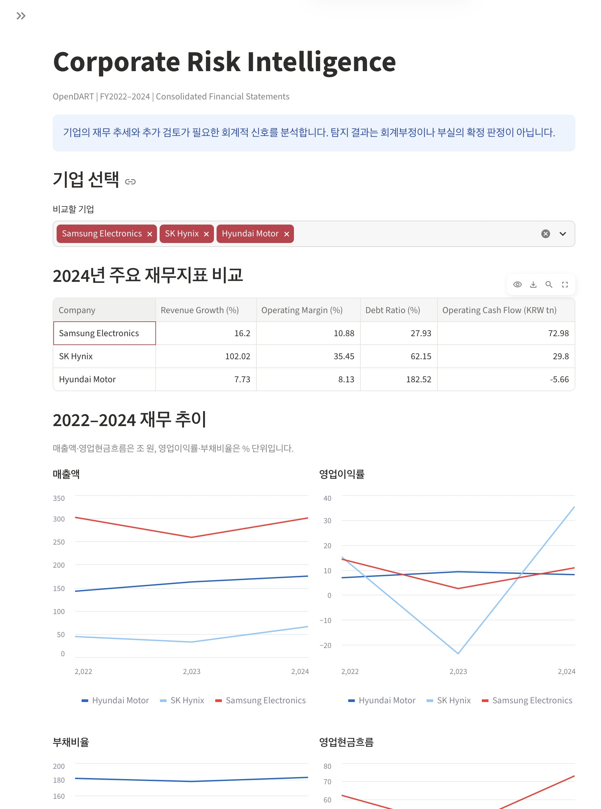

# Corporate Risk Intelligence

**OpenDART 기반 기업 재무위험 스크리닝 대시보드**  
*Financial statement analysis · Comparative validation · Explainable risk screening*

[대시보드 실행하기](https://corporate-risk-intelligence.streamlit.app)

상장기업의 연결재무제표를 자동 수집하고, **2022~2024년 재무 추이와 현금흐름·운전자본 관련 이상징후**를 비교합니다. 계정 매핑과 전기 비교금액의 일관성을 확인하고, 검증이 보류된 항목은 무리하게 해석하지 않습니다. 탐지 결과에는 **관찰 사실, 가능한 회계적 해석, 추가 확인사항**을 함께 제시합니다.

> **분석 범위:** 삼성전자 · SK하이닉스 · 현대자동차 / 2022~2024 사업연도 / 연결재무제표(CFS)  
> **분석 방식:** Python 규칙 기반 스크리닝 및 자동 요약. **생성형 AI(LLM)는 현재 사용하지 않습니다.**

## Dashboard

- **Financial Risk Dashboard:** 기업별 매출액, 영업이익률, 부채비율, 영업현금흐름의 3개년 추이
- **Comparative validation:** 공시 연도 간 비교금액 및 계정 식별자 일관성 점검
- **Risk screening:** 매출 대비 매출채권·재고 증가율 괴리, 순이익과 영업현금흐름 방향 차이
- **Financial Risk Summary:** 검증된 데이터와 탐지 결과에 기반한 한국어 규칙 기반 3줄 요약
- **Samsung Analysis:** 삼성전자 개별 재무 분석 페이지


## Dashboard Preview

### 1. 재무 추이 대시보드


### 2. 재무 분석 대시보드


### 3. 재무 위험 신호 및 자동 요약


## 실제 기업 분석 사례

아래 수치는 개발 과정에서 수행한 **2022~2024년 OpenDART 연결재무제표 분석 결과**입니다. 최종 게시 전 원천 공시 및 최신 실행 결과와 재대조할 예정입니다. **이상징후는 원인이나 부실을 확정하는 판단이 아닙니다.**

### 사례 1 — SK하이닉스: 2023년 매출과 매출채권 증가율 괴리

| 지표 | 2023년 전년 대비 |
|---|---:|
| 매출 성장률 | -26.57% |
| 매출채권 증가율 | +27.27% |
| 두 증가율의 격차 | **+53.84%p** |

**관찰:** 매출 감소와 동시에 매출채권 잔액이 증가했습니다.  
**회계적 해석:** 현금 회수 속도 또는 신용판매 조건의 변화 가능성을 검토할 신호입니다. 이 결과만으로 매출 인식 오류나 채권 부실을 판단할 수 없습니다.  
**추가 확인:** 매출채권 회전기간(DSO), 대손충당금, 고객별 결제조건, 관련 공시 주석.

### 사례 2 — 현대자동차: 2024년 순이익과 영업현금흐름의 방향 차이

| 지표 | 2024년 전년 대비 변화 |
|---|---:|
| 연결 순이익 | **+약 0.96조 원** |
| 영업활동현금흐름 | **-약 3.14조 원** |

**관찰:** 순이익은 증가했으나 영업활동현금흐름은 감소했습니다.  
**회계적 해석:** 발생주의 손익과 실제 현금흐름의 차이를 분해해 확인할 필요가 있습니다. 특히 현대자동차 연결재무제표에는 금융사업이 포함되므로 제조업 운전자본 문제로 단정할 수 없습니다.  
**추가 확인:** 영업자산·부채 증감, 비현금 손익 조정, 금융사업 관련 현금흐름 및 주석.

## 분석 로직과 검증 원칙

| 영역 | 지표 또는 검사 | 해석 시 유의사항 |
|---|---|---|
| 성장성 | 매출 성장률 | 전기 비교금액 검증 후 산출 |
| 수익성 | 영업이익률, ROA | 업종·사업구조 차이 고려 |
| 안정성 | 부채비율, 유동비율 | 금융사업 포함 여부 고려 |
| 현금창출력 | 영업현금흐름/순이익 | 순이익이 양수일 때 해석; 현금흐름 원인 별도 확인 |
| 운전자본 | 매출채권·재고 증가율, DSO | 성장률 괴리는 추가 검토 신호일 뿐 확정 진단 아님 |
| 데이터 신뢰성 | 계정 매핑, 재무상태표 등식, 비교금액 일치 여부 | 미검증 비교값을 이용한 일부 성장률·스크리닝 보류 |

**검증 원칙:** 전기 비교금액의 일치 또는 승인된 동등 계정 매핑이 확인되지 않으면 관련 성장률 기반 검사를 보류합니다. 2023년 현대자동차 매출 성장률 관련 비교정보 등은 별도 검토 대상으로 남겨둡니다.

### 개발 과정의 검증 기록 (2026-11-18)

| 항목 | 건수 |
|---|---:|
| 비교 계정 점검 | 66 |
| PASS | 60 |
| PASS_EQUIVALENT | 4 |
| REVIEW | 2 |
| 탐지된 스크리닝 신호 | 5 |
| 검증 보류로 건너뛴 검사 | 2 |

`REVIEW` 2건은 현대자동차의 2022년 매출액·영업이익 전기 비교금액과 관련됩니다. 이 수치는 개발 당시 테스트 기록이며 모든 공시상 차이의 원인을 규명했다는 의미는 아닙니다.

## 기술 스택 및 구조

- **Python / Pandas:** 재무데이터 가공 및 지표 계산
- **OpenDART API:** 연결재무제표 수집
- **Streamlit:** 대시보드, 추이 그래프, 기업별 요약
- **GitHub Codespaces:** 개발 환경
- **규칙 기반 분석 엔진:** `financial_engine/`의 계정 매핑, 검증, 비교가능성 감사, 위험 신호 탐지, 설명·요약

```text
app.py                          # Streamlit 진입점 및 페이지 메뉴
dashboard/
  financial_risk_dashboard.py   # 메인 3개년 대시보드
pages/
  1_Samsung_Analysis.py         # 삼성전자 상세 분석
financial_engine/               # 데이터 수집·검증·비율·탐지·설명 엔진
run_pipeline.py                 # 기업별 통합 분석 실행
```

## 실행 방법

```bash
python -m pip install -r requirements.txt
python -m streamlit run app.py
```

OpenDART API 키는 소스코드에 직접 입력하지 않고 환경변수 또는 Streamlit Secrets를 통해 설정합니다. 필요한 키 이름과 설정 방식은 실제 코드의 `financial_engine/dart_client.py`를 기준으로 확인하세요. **키를 GitHub에 커밋하지 마세요.**

## 한계와 향후 확장

- 위험 탐지 임계값은 **실증적으로 검증되지 않은 잠정 기준**입니다.
- 탐지 신호는 회계부정, 부도, 신용등급 하락의 확정 또는 예측을 뜻하지 않습니다.
- 업종 및 연결범위 차이, 특히 금융사업 포함 여부가 기업 간 비교에 영향을 줍니다.
- 비교금액 불일치 원인과 현금흐름 변동 원인은 주석 및 세부 계정 대조가 필요합니다.
- 현재 3줄 요약은 **규칙 기반 자동 생성**이며 LLM API를 사용하지 않습니다. 향후 선택적으로 생성형 AI를 연결할 수 있습니다.
- 머신러닝 이상치 탐지 및 과거 백테스팅은 현재 구현 범위에 포함되지 않습니다.

**Disclaimer:** 교육·취업 포트폴리오 목적으로 제작되었습니다. 투자 권유나 기업 신용평가 결과가 아닙니다.
